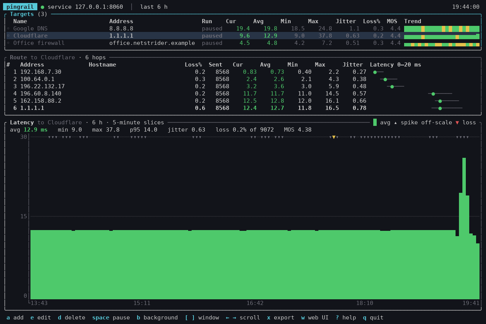
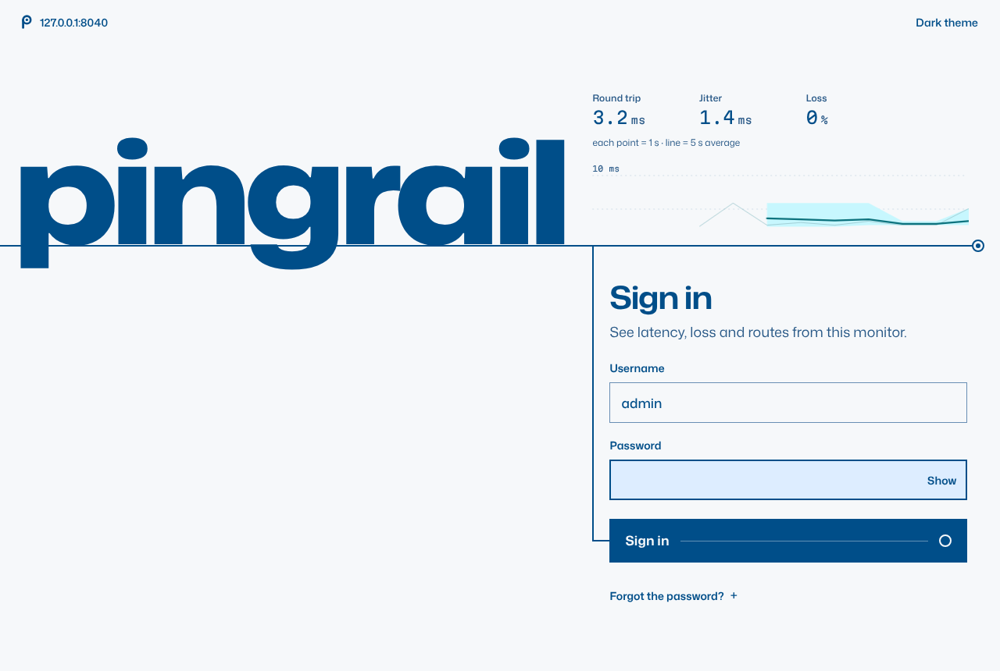
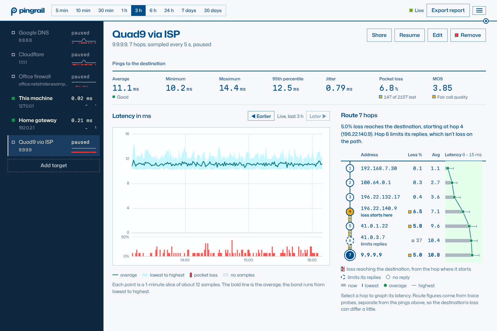
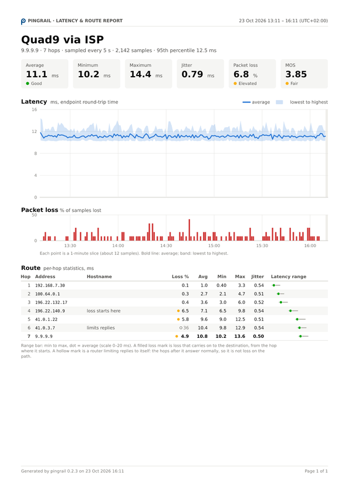
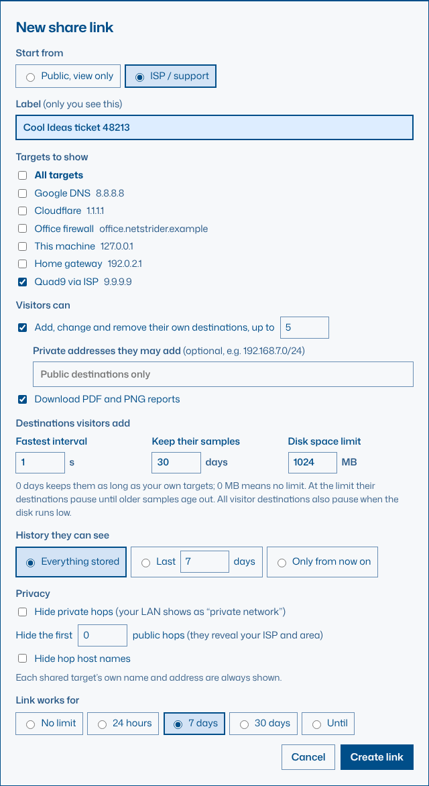
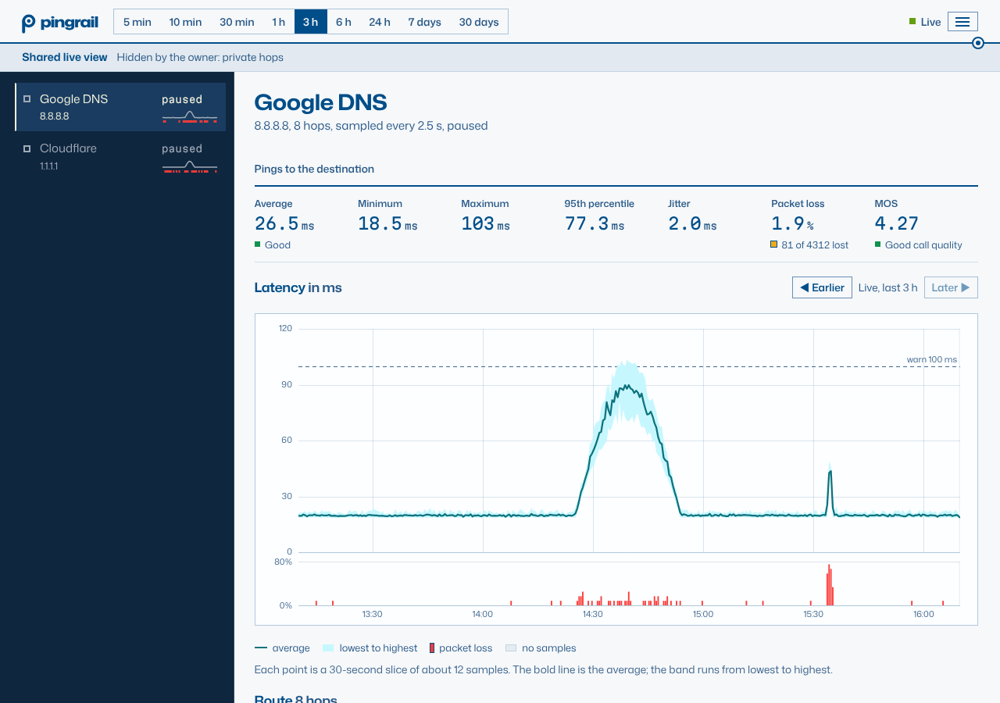

# pingrail

pingrail pings many hosts at once, traces the route to each of them, and records
latency, jitter, packet loss and an estimated call-quality score (MOS) for the
destination and for every hop on the way. It does the job PingPlotter does, as:

- a **terminal UI** (TUI) with a live target table, per-hop route table and a
  latency timeline you can scroll back through;
- a **background service** (Windows service / systemd unit) that keeps
  monitoring when the TUI is closed and starts at boot;
- a password-protected **web UI** served by that service, with the same graphs;
- **PDF and PNG reports** for any time range, from the TUI, the web UI or the
  command line;
- **share links** that let someone else (your ISP, a forum) watch chosen graphs
  live in a browser without an account, optionally adding their own destinations.



pingrail is open source under the Apache License 2.0. Copyright © 2026
Ulrich Holtzhausen. Everything it serves is HTTPS only.

## Install

Download the installer or package for your system from the [latest release](https://github.com/ulrich-za/pingrail/releases/latest).

### Windows 10/11 and Windows Server

Run `pingrail-0.3.1-x64.msi`. It:

- installs `pingrail.exe` to `C:\Program Files\pingrail` and adds that folder to `PATH`;
- adds a **pingrail** Start menu shortcut (opens the TUI);
- registers and starts the **pingrail latency monitor** service (automatic start), running
  as the low-privilege **LocalService** account rather than SYSTEM;
- removes hopwatch if it's installed (see [Coming from hopwatch](#coming-from-hopwatch));
- opens TCP 8040 (web UI) and 8041 (share links) in Windows Firewall for *private*
  and *domain* networks (not public);
- makes pingrail's own [certificate authority](#https) and adds it to this PC's
  trusted certificates, so browsers on this PC open the web UI without a warning
  (uninstalling removes it again).

Data lives in `C:\ProgramData\pingrail` (config, database, API token, log, the
certificate authority `ca.pem` / `ca-key.pem` and the HTTPS certificate
`cert.pem` / `key.pem`; the keys are readable only by the service, SYSTEM and
Administrators). Report fonts are in
`C:\Program Files\pingrail\fonts`.
Uninstall from *Settings → Apps*; your data folder is kept.

No administrator rights are needed to *use* pingrail: ICMP goes through the
Windows IP Helper API (`IcmpSendEcho`, the same one `tracert` uses). Nothing
else needs installing either: the OpenSSL that passkeys use is compiled into
`pingrail.exe`.

### Debian, Ubuntu, Raspberry Pi OS

```sh
sudo apt install ./pingrail_0.3.1-1_amd64.deb     # or _arm64.deb on a Raspberry Pi 4/5
```

The package:

- installs `/usr/bin/pingrail` and gives it `CAP_NET_RAW` (raw ICMP without sudo);
- creates a `pingrail` system user, `/etc/pingrail/pingrail.toml` and `/var/lib/pingrail`;
- enables and starts `pingrail.service` (runs as `pingrail`, only `CAP_NET_RAW`, hardened);
- creates the service's certificate authority and HTTPS certificate, and prints
  the authority's fingerprint;
- lets the user who ran `sudo apt install` read the service's API token and
  certificate, so their TUI connects without a password or a trust prompt;
- replaces the hopwatch package if it's installed (use `apt install`, not
  `dpkg -i`, so apt can remove it).

Other users can still use the TUI and CLI by logging in with the web UI password.

`sudo apt remove pingrail` stops the service; `sudo apt purge pingrail` also deletes data and config.

### From source

```sh
cargo build --release
sudo ./target/release/pingrail service install     # Linux: systemd unit + start at boot
# Windows (Administrator prompt): pingrail.exe service install
```

Requires Rust 1.88+. `packaging/build-release.sh` builds the .deb packages and the MSI;
see [Building the Windows installer](#building-the-windows-installer) to build just the MSI.
Reports look for the DejaVu fonts in `assets/fonts` during development; installed
copies find them beside the program (`fonts\` on Windows), in
`/usr/share/pingrail/fonts`, in the distribution's `fonts-dejavu-core` package, or
in `PINGRAIL_FONT_DIR`, and fall back to the system's fonts.

### Upgrading from 0.2

0.3 replaces the old self-signed certificate with pingrail's own
[certificate authority](#https) on first start. On the Windows PC running
pingrail the installer trusts it; other computers that used `pingrail trust`
need it once more, and phones and browsers need the authority (menu › **Set up
a phone**). If a Cloudflare Tunnel verifies pingrail's certificate, point its
`caPool` at `ca.pem` and restart cloudflared. Saved passwords move to the new
hashing settings the next time they sign in.

### Coming from hopwatch

pingrail is hopwatch's new name. Installing pingrail removes hopwatch, and the
first time pingrail starts it imports hopwatch's database (history, web
password, share links) and `hopwatch.toml` settings. Existing share links keep
working with the same codes. hopwatch's folder (`C:\ProgramData\hopwatch` or
`/var/lib/hopwatch` and `/etc/hopwatch`) is left untouched; delete it once you're
happy. The import only runs while pingrail has no database of its own.

## First run

1. Open the TUI: run `pingrail` (or the Start menu shortcut).
2. It asks you to set a **web UI password** (username `admin`). Do it, or press
   Esc and set it later with `P`.
3. Add a target with `a`, or press `1`, `2` or `3` on the empty screen to add
   Cloudflare DNS, Google DNS or your default gateway.
4. Open the web UI at `https://<this machine>:8040/` and sign in. On the Windows
   PC running pingrail the browser trusts it straight away. On other computers
   and phones it warns once, until they trust pingrail's certificate authority:
   check that the SHA-256 fingerprint matches the one on the TUI's `w` screen
   (or `pingrail status`), continue, then set them up as described under
   [HTTPS](#https). Phones are easiest from the menu's **Set up a phone**.
5. Optionally add a [passkey](#passkeys) from the menu, so you can sign in with
   your phone or this computer's screen lock instead of the password.

The sign-in page measures the round trip from your browser to the monitor while
it's open, so you can see at a glance whether the server is answering and how
fast. After repeated wrong passwords it counts down to when you can try again.



If the background service isn't running, the TUI starts a **local session**
instead (shown in yellow in the header). Everything works, but monitoring stops
when you quit.

## Foreground and background

Targets you add in the TUI run in the **foreground**: they stop when that TUI
closes. Press `b` on a target to move it to the **background**; it keeps running
in the service after you quit and shows up in the web UI. `B` moves all of them.

When you quit with foreground targets still running, pingrail asks whether to
keep them running in the background or stop them. If a TUI crashes or loses its
connection, its foreground targets are paused after 30 seconds, not deleted.

Targets added in the web UI or with `pingrail targets add` always run in the background.

The **Run** column shows `tui` (foreground), `bg` (background), `link` (added by
a visitor through a share link) or `paused`.

## Terminal UI keys

| Key | Action |
|---|---|
| `↑` `↓` / `j` `k` | select a target (or a hop after `Tab`) |
| `Tab` | switch between the target table and the route table |
| `a` | add a target |
| `e` / `Enter` | edit (name, interval, route tracing, background) |
| `d` / `Del` | remove a target and its history |
| `space` / `p` | pause or resume |
| `b` / `B` | move the selected / all foreground targets to the background |
| `[` `]` | time window: 1 min, 5 min, 10 min … 24 h, 48 h, 7 days, 30 days |
| `←` `→` / `h` `l` | scroll back / forward in time; `End` returns to live |
| `x` | export a PDF/PNG report |
| `w` | web UI address and password status |
| `P` | set the web UI password |
| `i` | about: version, copyright, licence |
| `?` | help |
| `q` | quit |

The mouse wheel and clicks select targets too.

To watch a service on another machine (a Pi on your LAN, say), trust its
certificate authority once, then connect:

```sh
pingrail trust https://192.168.1.20:8040      # shows the fingerprint and asks
pingrail --connect https://192.168.1.20:8040
```

Compare the fingerprint `trust` shows with the one on that machine's `w`
screen. You'll be asked for the web UI password.

## HTTPS

pingrail only speaks HTTPS: the web UI (8040), share links (8041), local TUI
sessions and the connection between the TUI/CLI and the service. A plain
`http://` request gets nothing but a redirect to the `https://` address.

By default the service makes its own **certificate authority** on first start
(`ca.pem` and `ca-key.pem` in its data folder, valid for ten years) and issues
the web UI's certificate from it (`cert.pem` and `key.pem`, valid for 397 days).
The certificate covers `localhost`, the machine's name (with `.local` and any
DNS search domain it was given, such as `mypc.lan`), its LAN address and
any name you add in the web UI. pingrail renews it by itself a month before it
expires, or when the machine's name or address changes, without a restart.

Trust the authority once on each computer or phone and every certificate it
issues is trusted:

- **Phones and tablets**: menu › **Set up a phone** shows two large QR codes:
  the first downloads the authority (compare its fingerprint), the second opens
  pingrail. iPhone: install the downloaded profile in *Settings › General ›
  VPN & Device Management*, then turn it on in *Settings › General › About ›
  Certificate Trust Settings*. Android: *Settings › Security › Encryption &
  credentials › Install a certificate › CA certificate*.
- **The Windows PC running pingrail**: the installer already did it
  (`pingrail service trust add` as Administrator does it again).
- **Other computers**: download `https://<this machine>:8040/ca.crt` and add it
  to the system's trusted root certificates (Windows: double-click it, *Install
  Certificate*, *Local Machine*, *Trusted Root Certification Authorities*; macOS:
  open it in Keychain Access and set it to *Always Trust*; Debian/Ubuntu: copy it
  to `/usr/local/share/ca-certificates/pingrail.crt` and run
  `sudo update-ca-certificates`). Firefox keeps its own list: *Settings › Privacy
  & Security › Certificates › View Certificates › Authorities › Import*.

The authority can only vouch for this machine: its name constraints allow names
nobody can register publicly (`localhost`, `*.local`, `*.home.arpa`,
`*.internal`, `*.lan`, `*.home`), this machine's own names and private
addresses. Even someone who stole its key couldn't impersonate a public website
to a device that trusts it.

The TUI and CLI on the same machine trust the service automatically; other
machines trust it with `pingrail trust <url>` after you compare fingerprints.
If you open pingrail by a name the certificate doesn't cover yet, the web UI
offers to add it. A name outside the authority's limits means a new authority,
which devices must trust again (pingrail says so). Delete `ca.pem` and
`ca-key.pem` and restart the service to start over.

To use your own certificate (from your CA, Let's Encrypt, or a Cloudflare Origin
CA certificate), point pingrail at the PEM files and restart the service:

```toml
[tls]
cert_file = "/etc/pingrail/fullchain.pem"
key_file = "/etc/pingrail/privkey.pem"
```

A certificate your operating system trusts needs no `pingrail trust` step.
pingrail re-reads the files when they change, so renewing them needs no restart.

## Passkeys

A passkey signs you in with your phone, a security key or this computer's
screen lock (Windows Hello, Touch ID, Android or iPhone) instead of the
password, and can't be phished: it only works on the real pingrail.

Add one from the web UI's menu › **Passkeys** on each device you sign in from
(changes need a sign-in from the last ten minutes; pingrail asks you to confirm
otherwise). Sign in with **Sign in with a passkey**, or pick it from the
username box's suggestions.

Browsers only allow passkeys on a **name** (not an IP address) whose
certificate they trust, so open pingrail as `https://mypc.lan:8040` or
similar on a device that trusts pingrail's [certificate authority](#https). A
passkey belongs to the name it was made on.

**Require a passkey to sign in** turns password sign-in off. If you lose every
passkey, run `pingrail passkeys reset` on the machine running the service: it
removes them all and lets the password sign in again.

Adding or removing a passkey, or requiring them, signs you out everywhere else.

## Graphs



The latency graph looks the same whatever the time window or sample interval,
so a link you send lands on a trustworthy picture:

- **Short windows** draw every sample. When there are more samples than room,
  pingrail groups them into equal time slices aligned to the clock (5 s, 10 s,
  30 s, 1 min …), never narrower than two sample intervals, so slices never
  come out empty just because of their size.
- The **bold line** is the average: a moving average (about 30 s, at least five
  samples) when every sample is drawn, or each slice's average when they're
  grouped. Behind it, a lighter line shows the samples, or a band each slice's
  lowest to highest.
- **Gaps** appear only where samples were really missing (each sample keeps the
  interval it was taken with), so changing a target's interval or adding
  destinations doesn't break up the line.
- The **scale** follows the bulk of the data and only steps up or down when the
  data moves well outside it, so it doesn't jump with every spike. Tables and
  tooltips always show the true maximum (the TUI marks off-scale spikes with ▴).
- Live graphs glide forward smoothly between updates. A caption under each graph
  says what it shows, for example *Each point is a 10 s slice of about 4
  samples. The bold line is the average; the band runs from lowest to highest.*
- The **route graph** shows each hop's average joined hop to hop, with its
  min–max range, like PingPlotter's.

The web UI, share links, TUI and reports all use the same rules.

Colour carries meaning in the web UI: green is healthy, amber is elevated, red
is loss; the route graph tints its good, elevated and high latency zones the
same way, and the bright yellow-green square next to *Live* is the only one of
its kind, so you notice when it goes. The palette is generated
(`packaging/tools/palette/generate.py`): every text colour clears 4.5:1 on
every surface it can sit on, and the status colours stay apart for people
with red-green or blue-yellow colour blindness.

### Reading a route

On a wide screen the route hangs beside the latency graph, hop by hop from the
top down to the destination; select a hop and the graph next to it shows that
hop. pingrail reads the route for you instead of leaving it to the eye:

- Loss only counts against a hop if it **carries on**: every later hop, the
  destination included, has to lose at least as much. The rail is hatched from
  the first hop where that loss starts down to the destination, and that hop is
  marked *loss starts here*.
- A hop that loses replies the hops after it don't is a router limiting how
  often it answers. It's drawn dashed and marked *limits replies*, and its loss
  is shown neutral, never in the loss colour.
- A hop that never answers while later hops do is drawn dotted, *no reply*.
- If the destination itself loses nothing, nothing is flagged, however bad a
  middle hop looks.
- One sentence above the hops says what the route shows, for example *4.9% loss
  reaches the destination, starting at hop 4 (196.22.140.9). Hop 6 limits its
  replies, which isn't loss on the path.*

The line above the headline numbers says what they describe: pings to the
destination, or trace probes to the hop you selected (with no call-quality
score, which only means something end to end). Reports and the TUI mark hops
the same way.

## Reports

Every report has a summary page (when it covers more than one target) and one
page per target with headline stats, a latency chart with the min–max range, a
packet-loss chart on the same time axis, and the per-hop route table.

- **TUI**: `x`, pick a range (current view, last hour/day/week, or exact times),
  the selected or all targets, PDF/PNG/both, and a folder.
- **Web UI**: *Export report*.
- **CLI**:

```sh
pingrail export --last 24h -f pdf                         # all targets, last day
pingrail export --from "2026-10-22 08:00" --to "2026-10-22 12:00" -t "Google DNS" -f png -o morning.png
```

Times in reports are shown in the requesting computer's time zone. PNG output
stacks the pages into one tall image.



## Share links

A share link lets someone watch your graphs live in their browser, without an
account and without seeing anything you didn't pick. Make one in the web UI:
select a target and press **Share**, or open **☰ → Share links**.

Each link has its own settings, so you can post a view-only link on a forum and
send your ISP a different link to the same graphs that also lets them test:

| Setting | What it does |
|---|---|
| Targets to show | Which of your targets the link shows. Everything else stays invisible. |
| Add, change and remove their own destinations, up to N | Visitors can add, pause, edit and remove destinations of their own (public addresses only, unless you list private ranges they may use). They can never change or remove yours. Turn it off and the destinations they added stay visible but can't be changed. |
| Download PDF and PNG reports | Shows *Export report* to visitors. |
| History they can see | Everything stored, the last N days, or only from when the link was made. |
| Hide private hops | Your LAN hops show as “private network”. On by default for public links; untick it when showing your own router helps prove a point. |
| Hide the first N public hops | Hides the first routers of your ISP, which can reveal your provider and area. |
| Hide hop host names | Drops reverse-DNS names from the route table. |
| Link works for | No limit, 24 hours, 7 days, 30 days or until a date. |
| Fastest interval | The shortest sample interval visitors may give their destinations. |
| Keep their samples | How long samples of visitors' destinations are kept (0 = as long as yours). |
| Disk space limit | Storage limit for this link's visitor destinations (0 = no limit). At the limit they pause until older samples age out or you raise it. |



Two starting points fill these in for you: **Public, view only** (graphs only,
private hops hidden) and **ISP / support** (up to 5 destinations of their own,
reports allowed, expires after 7 days).

A link's page carries only what that link allows: a view-only link's page has no
add, edit, remove or export controls, and not the code behind them either. If
you change what a link allows, pages that are open reload within a minute.

From the list of links you can copy a link, edit it, **make a new link** (the old
address stops working at once), **switch it off** or delete it. Anyone opening a
switched-off, expired or mistyped link gets a page that says so. When a link is
switched off or expires, the destinations visitors added are paused, not deleted;
they stay in your target list marked *via \<link name\>*.
`pingrail shares list` and `pingrail shares revoke <id|name>` do the same from a terminal.

What a visitor with the ISP link sees, with one destination of their own:



### Sharing beyond your network

Share links are served on their **own port, 8041**, which answers only share
pages (`/s/<code>`): no admin UI, no sign-in page, no admin code, no API for your
targets. Point a tunnel or reverse proxy at **https://localhost:8041, never at
8040**.

With a [Cloudflare Tunnel](https://developers.cloudflare.com/cloudflare-one/connections/connect-networks/)
on the pingrail machine:

```yaml
# ~/.cloudflared/config.yml
tunnel: pingrail
credentials-file: /home/you/.cloudflared/<tunnel-id>.json
ingress:
  - hostname: pingrail.example.com
    service: https://localhost:8041
    originRequest:
      # Verify pingrail's certificate against its authority (or set
      # noTLSVerify: true; the hop from cloudflared to pingrail never leaves
      # this machine).
      caPool: /var/lib/pingrail/ca.pem
      originServerName: localhost
  - service: http_status:404
```

In the Cloudflare dashboard instead: edit the tunnel's public hostname, set the
service type to **HTTPS** and the URL to `localhost:8041`, and under
*Additional application settings → TLS* turn on **No TLS Verify** (or set
*Origin Server Name* to `localhost` and give cloudflared pingrail's `ca.pem`
as its CA pool). An `http://` service URL no longer works: pingrail answers it
with a redirect only.

Then tell pingrail the public address, so the links it gives you use it, and
restart the service:

```toml
[share]
public_url = "https://pingrail.example.com"
```

For a one-off, `cloudflared tunnel --url https://localhost:8041 --no-tls-verify`
prints a temporary `https://….trycloudflare.com` address you can use as
`public_url`.

If the tunnel runs on the same machine, `listen = "127.0.0.1:8041"` keeps share
pages off your LAN. Behind Cloudflare or a local proxy, the visitor address shown
for each link comes from `CF-Connecting-IP` / `X-Forwarded-For`.

Share pages are cached for a couple of seconds and rate-limited per link and per
visitor address, so a busy forum thread doesn't load the monitor. If free disk
space falls below `storage.min_free_mb`, every visitor destination pauses; your
own targets keep running.

## Command line

```text
pingrail                         open the TUI
pingrail status                  is the service running, how many targets
pingrail targets list
pingrail targets add <host> [--name N] [--interval SECONDS] [--no-trace]
pingrail targets remove|pause|resume <id|host|name>
pingrail shares list                         share links, what they allow, their addresses
pingrail shares revoke <id|name>             switch a link off now
pingrail export [--last 1h | --from T --to T] [-t TARGET]... [-f pdf|png] [-o FILE]
pingrail passwd [--user admin] [--generate]
pingrail passwd --tune                       re-time password hashing for this machine
pingrail passkeys list                       everyone's passkeys, and whether they're required
pingrail passkeys remove <id>
pingrail passkeys reset                      remove every passkey; the password signs in again
pingrail service install|uninstall [--purge]|start|stop|status
pingrail service run [--listen ADDR]          what the service manager runs
pingrail service trust add|remove            trust the service's certificate authority on this computer
pingrail trust <url> [--fingerprint FP]      trust another machine's service (its authority)
pingrail about [--license | --third-party]   version, copyright and licence

Global options:
  --connect URL     use the service at URL, e.g. https://pi:8040 (also PINGRAIL_URL)
  --local           run a local session without the service
  --data-dir DIR    keep config, database and token in DIR (also PINGRAIL_DATA_DIR)
```

For scripts that can't read the token, set `PINGRAIL_USER` and `PINGRAIL_PASSWORD`.

## Configuration

`/etc/pingrail/pingrail.toml` (Linux) or `C:\ProgramData\pingrail\pingrail.toml`
(Windows). Restart the service after changes.

```toml
[web]
listen = "0.0.0.0:8040"     # "127.0.0.1:8040" = this machine only
session_hours = 168         # web sign-in lifetime

[tls]
cert_file = ""              # PEM certificate; empty = one from pingrail's own authority
key_file = ""

[share]
listen = "0.0.0.0:8041"     # share-link-only port; "" = serve links on the web UI port
public_url = ""             # e.g. "https://pingrail.example.com" behind a tunnel
trusted_proxies = ["127.0.0.1", "::1"]   # may set X-Forwarded-For / CF-Connecting-IP

[probe]
interval_ms = 2500          # default for new targets
timeout_ms = 2000
packet_size = 56
max_hops = 30
hop_stagger_ms = 5          # spacing between hop probes in one sample
reverse_dns = true          # look up hop host names

[storage]
retention_days = 30
min_free_mb = 1024          # below this, share-link visitors' destinations pause

[thresholds]                # colours in the TUI, web UI and reports
warn_ms = 100.0
crit_ms = 200.0
loss_warn_pct = 1.0
loss_crit_pct = 10.0
```

## How it measures

- Each sample sends one ICMP echo request to the destination (TTL 64) and, when
  route tracing is on, one echo request per hop with TTL 1, 2, 3… Routers answer
  with *time exceeded*; the destination answers with an echo reply. Once the
  route length is known, later samples only probe up to the destination, and the
  route is rediscovered automatically if it gets longer.
- Samples run on their own schedule (default every 2.5 s) and are stored in
  SQLite (`pingrail.db`), so any period can be graphed or reported later.
- **Jitter** is the mean absolute difference between consecutive replies.
- **MOS** uses the simplified ITU-T G.107 E-model common to monitoring tools:
  effective latency = average + 2 × jitter + 10 ms, then a loss penalty.
- Loss at a middle hop that does **not** continue to later hops is that router
  limiting how often it answers, not real packet loss. Loss that starts at a hop
  and carries on to the destination is real. pingrail works this out from the
  lowest loss at each hop or any later one (see [Reading a route](#reading-a-route)),
  and only once the destination itself shows loss above the warning level.
- What pings can't tell apart: a router that drops ping traffic *passing
  through* it (not just replies to itself) looks exactly like real loss, because
  every later hop loses it too. Loss seen only at the destination may be its
  last link or the destination limiting its own replies; pingrail says so.
- See [Graphs](#graphs) for how samples become lines.

## Security notes

- **HTTPS only**, TLS 1.2 and 1.3 (rustls). Nothing is served over plain HTTP:
  `http://` requests get a redirect and the connection is closed.
- The service's API accepts either the **API token** in its data directory
  (used by the TUI/CLI on the same machine) or a **web session** from signing in.
  On Linux the token is readable only by the `pingrail` user and the installing
  user; on Windows by local users (the default ProgramData permissions). The
  private keys of the certificate and its authority are readable only by the
  service (and, on Windows, SYSTEM and Administrators). If they can't be read,
  pingrail stops rather than quietly making a new authority.
- Web passwords are stored as **Argon2id** hashes sized to the machine: on first
  start pingrail gives each check 2 % of the memory (or 10 % of what's free,
  whichever is less, between 19 and 256 MiB) and times the passes so a check
  takes about a third of a second, never below OWASP's minimum. One or two
  checks run at once, depending on memory. Saved passwords move to new settings
  the next time they sign in; `pingrail passwd --tune` re-times after a hardware
  change (it happens by itself when the memory changes by more than a fifth).
  Unknown usernames take as long to check as real ones.
- Sign-in (password or passkey) is rate-limited for everyone together,
  repeated failures from one address are slowed and, after 20 in 15 minutes,
  refused for 15 minutes (the refusal carries `Retry-After`, which the sign-in
  page counts down). Changing the password signs out every session.
- **Passkeys** are WebAuthn credentials checked with webauthn-rs, which require
  user verification (a PIN, fingerprint or face). They work only on the web UI
  port, on a name on the certificate; the share port has none of their
  addresses. Adding or removing passkeys, requiring them or making a new
  certificate authority needs a sign-in from the last ten minutes, and signs
  out every other session.
- Session cookies are stored as their SHA-256, so a copy of the database can't
  be used to sign in.
- The session cookie is `__Host-`, `Secure`, `HttpOnly` and `SameSite=Strict`.
  Changes made in the web UI are also refused if the request's `Origin` doesn't
  match its `Host`. `X-Forwarded-Host` counts only from `share.trusted_proxies`,
  so behind a reverse proxy on another machine, list it there.
- Keep the admin UI (8040) on your LAN or VPN. For remote access, put Tailscale,
  WireGuard or Cloudflare Access in front of it rather than port-forwarding.
- Share-link codes are 160-bit random values. A link only ever reveals the
  targets, history and hop details you chose for it, and the share port has no
  route to the admin API. Making a new link or switching it off takes effect
  immediately.
- The admin UI and share pages are cut from one source at start-up, so each page
  carries only what its viewer can use: visitors never receive the sign-in view,
  password or share-link dialogs, or anything that talks to the admin API; a
  view-only link's page has no add, edit or remove controls and a link without
  reports has no export dialog (nor the code behind either). The share port
  doesn't serve the admin script at all. Scripts never write HTML: every value
  reaches the page as text.
- Pages send `noindex, nofollow`, so sign-in and share pages stay out of search
  engines.
- The web UI is self-contained (no CDN, fonts built in), so it works on isolated
  networks.

Share pages are the part that may face the internet, so they're built to give
nothing away and to shrug off abuse:

- **No guessing.** An address that tries 20 wrong codes within 10 minutes is
  blocked for 15 minutes; opening a share page with a made-up code counts too.
  Codes are checked against an in-memory list, so floods of made-up codes never
  reach the database.
- **No injection.** Every database query uses bound parameters; names, labels and
  reverse-DNS host names are stripped of control, invisible and bidirectional
  characters before they're stored or shown, and pages render text, never HTML.
  A strict Content-Security-Policy, `nosniff`, `frame-ancestors 'none'` and
  `no-referrer` are sent with every page.
- **No overload.** History requests are rounded to fixed windows and point counts
  so they cache well, cost more the longer they are, and come out of per-link and
  per-address budgets. They run on their own database connection, so a visitor
  can't slow the service or the admin UI. Connections are capped in total and
  per address, slow or idle clients are cut off, and long requests time out.
- **No pivoting.** Visitors' destinations must be globally routable: IPv6 only
  from 2000::/3, and in both IPv4 and IPv6 every block in IANA's special-purpose
  address registries is refused (private, loopback, link-local, carrier-grade
  NAT, documentation, benchmarking, Teredo, 6to4, ORCHID, multicast…), as are
  IPv4-mapped and NAT64 addresses that carry one of those. The check runs again
  on every probe, so a DNS name that later points somewhere private stops being
  probed. Private ranges you allow on a link apply to its visitors' destinations
  as the link says now, not as it said when they were added. Visitors can't
  probe faster than the link allows and can't fill your disk (per-link
  retention and storage limits plus the low-disk guard).
- **Real addresses only from proxies you trust.** `X-Forwarded-For`,
  `CF-Connecting-IP` and `X-Forwarded-Host` are honoured only from
  `share.trusted_proxies`.
- The Windows service runs as LocalService and the Linux service as its own user
  with only `CAP_NET_RAW`, so a flaw can't reach much else.

## Building release packages

```sh
packaging/build-release.sh
```

needs `cargo-deb`, `cargo-zigbuild` with Zig (`pip install ziglang`), `wixl`,
`gcc-mingw-w64-x86-64`, `perl` and `make` (OpenSSL, which passkeys use, is
compiled from source into every binary, so nothing needs installing where
pingrail runs), and the Rust targets `x86_64-unknown-linux-gnu`,
`aarch64-unknown-linux-gnu` and `x86_64-pc-windows-gnu`. Linux binaries are linked
against glibc 2.28 so the packages install on Debian 10+, Ubuntu 20.04+ and
Raspberry Pi OS Buster or later. Output goes to `dist/`; the GitHub Actions
workflow in `.github/workflows/release.yml` runs the same script on every `v*`
tag.

### Building the Windows installer

**On Windows**, with [MSYS2](https://www.msys2.org) (it provides the compiler,
Rust and `wixl`):

```powershell
winget install --id MSYS2.MSYS2
# then, in PowerShell, from the unpacked source folder:
powershell -ExecutionPolicy Bypass -File packaging\windows\build-msi.ps1
```

The script installs MSYS2's build tools on first use (including `perl` and
`make` for OpenSSL), compiles pingrail and writes
`dist\pingrail-<version>-x64.msi`.

**On Linux or WSL** (Ubuntu/Debian):

```sh
sudo apt update
sudo apt install -y build-essential perl gcc-mingw-w64-x86-64 wixl
curl --proto '=https' --tlsv1.2 -sSf https://sh.rustup.rs | sh -s -- -y
source "$HOME/.cargo/env"
rustup target add x86_64-pc-windows-gnu
packaging/build-msi.sh
```

Either way, `packaging/build-msi.sh` sorts the installer's tables after `wixl`
builds them (Windows Installer refuses tables that aren't in key order, with
error 2229) using `packaging/tools/msisort`, then checks every table and that
the installer records `pingrail.exe`'s version (without it, upgrading over an
installed pingrail fails with error 2753).

## Licence

Copyright © 2026 Ulrich Holtzhausen.

Licensed under the Apache License, Version 2.0 (see [LICENSE](LICENSE) and
[NOTICE](NOTICE)). Unless required by applicable law or agreed to in writing,
pingrail is distributed on an "AS IS" BASIS, WITHOUT WARRANTIES OR CONDITIONS OF
ANY KIND, either express or implied.

pingrail is a trademark of Ulrich Holtzhausen: the licence covers the code, not
the name, so forks are welcome under another name. The pingrail logo carries no
such restriction.

The libraries linked into pingrail are listed with their licence texts in
[THIRD-PARTY-NOTICES.txt](THIRD-PARTY-NOTICES.txt) (regenerate it with
`packaging/tools/third_party.py`). The web UI's fonts, Mona Sans and Martian
Mono, are built in unmodified under the SIL Open Font License 1.1
(`assets/fonts/web/`, texts also in the notices). The DejaVu fonts used for
reports are separate files under their own licence
(`assets/fonts/LICENSE-DejaVu.txt`).

The same details are under **☰ → About pingrail** in the web UI, `i` in the TUI
and `pingrail about` on the command line.

Questions and bug reports: [GitHub issues](https://github.com/ulrich-za/pingrail/issues).
